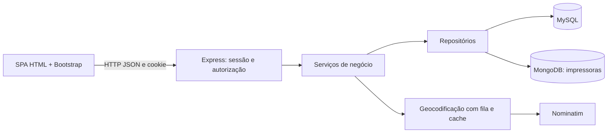

> Registro histórico da análise inicial. A implementação atual e suas decisões estão em [backend/README.md](../../backend/README.md) e [DECISIONS.md](../../DECISIONS.md). A proposta de tabela única de usuários não foi aplicada; a base enviada posteriormente foi preservada.

# CoNexo — proposta de backend para revisão

Data: 10/11/2026. **Fases 1 e 2 apenas: diagnóstico e proposta. Não há backend implementado.**

As categorias usadas são **Firme**, **Equipe — não validada pela AACD** e **Sugestão**. A explicação do estado real das branches, evidências e mapa de telas está em [DIAGNOSTICO.md](DIAGNOSTICO.md). O registro resumido de decisões está no [DECISIONS.md](../../DECISIONS.md).

## 1. Escolha de stack e custo de aprendizado

**Sugestão:** um único backend Node.js 24 LTS, JavaScript com módulos ES e Express 5; `mysql2/promise`, driver oficial `mongodb`, `bcrypt`, `express-session` com store MySQL, validação de entrada com Zod. Leaflet continua somente no front-end. Testes com `node:test`, cliente HTTP e Playwright para a integração.

A vantagem é aproveitar o JavaScript que já existe na SPA. Não é necessário aprender outra linguagem, ORM e framework simultaneamente. SQL explícito ajuda a explicar joins, normalização, transações e locks ao professor; o driver Mongo deixa visível a consulta que justifica o NoSQL. O custo novo está em HTTP/async, sessões, validação, consultas e transações — não é zero, mas cada assunto aparece no próprio problema do projeto.

Alternativas: Flask pode ser adequado se a equipe dominar Python mais do que JavaScript, mas divide linguagens e traz outra forma de organizar autenticação e deploy. Spring Boot é consistente, porém acrescenta Java, anotações e configuração nesta primeira entrega. NestJS/TypeScript acrescentariam conceitos antes de haver necessidade demonstrada. Não proponho microserviços, filas externas, Redis ou um backend por banco.

MySQL Workbench é um cliente visual: o banco roda no **MySQL Server**, que precisa estar instalado/iniciado separadamente. MongoDB também exige um servidor ou serviço acessível; Compass é opcional. Não há obrigação de usar Docker no Windows. Dependências e versões serão fixadas quando a stack for aprovada.

## 2. Organização e fluxo

**Sugestão de estrutura**, a criar somente na implementação:

```text
backend/
  package.json
  .env.example
  src/
    server.js                    # abre conexões e sobe HTTP
    app.js                       # monta middleware, rotas e front estático
    config.js                    # ambiente, domínio de links e pesos da fila
    db/mysql.js
    db/mongo.js
    routes/                      # URLs e middlewares por recurso
    controllers/                 # valida request e monta response
    services/                    # regras de autenticação, match e pedidos
    repositories/                # SQL e consultas Mongo, sem decisões de tela
    domain/pedido-status.js
    domain/fila.js
    domain/distancia.js
    middleware/                  # sessão, perfil, homologação e erros
    geo/                         # polígono Brasil e centros das UFs versionados
  scripts/seed-aacd.mjs
  tests/
```

Uma rota chama controller → service → repositories. Os bancos não são acessados pelo navegador. O serviço de match consulta primeiro Mongo, depois MySQL e só então calcula/ordena a distância.



O mesmo Express pode servir a SPA e `/api` no mesmo endereço. Na implementação, servir somente uma pasta dedicada de arquivos do front ou uma lista explícita de estáticos; nunca publicar a raiz inteira do repositório, `.env` ou arquivos do backend. Isso simplifica cookies e dispensa CORS no MVP. `data.js` continua como fronteira do front; um adaptador HTTP traduz IDs e nomes de campos. Os módulos de tela não importam Mongo/MySQL. A API retorna dados de domínio, não classes CSS, `displayNames`, contagens inventadas nem o nome dos inputs HTML.

Respostas de lista sugeridas: `{ "items": [...], "total": 12, "page": 1, "pageSize": 20 }`. Valores do exemplo são ilustrativos. IDs SQL saem como strings; ObjectId sai como string hexadecimal de 24 caracteres. `401` significa sessão ausente, `403` falta de permissão/homologação, `404` recurso não disponível ao usuário, `409` conflito de estado/concorrência e `422` campos inválidos. Não devolver stack trace nem SQL ao cliente.

## 3. Modelo relacional e divergências

O [DDL proposto](mysql-proposta.sql) usa InnoDB e MySQL 8.0.16+ ou 8.4, pois CHECK deve ser realmente aplicado. **Não foi executado.** Não é uma migração de produção e não contém dados pessoais ou senhas.

| Parte | Categoria | Motivo / divergência |
| --- | --- | --- |
| Usuário + tabelas 1:1 `aacd` e `parceiro` | Sugestão estrutural sobre os perfis firmes | Email/telefone/hash/perfil/homologação ficam uma vez em `usuario`; dados próprios ficam nas tabelas filhas |
| `homologado` começa falso nos cadastros públicos | Firme | Só processo autorizado ou seed pode atribuir aprovação; ignorar/rejeitar esse campo recebido do browser |
| Campos de parceiro e coordenadas em MySQL; impressoras em Mongo | Firme | Respeita a divisão definida com o professor |
| Materiais e bicos da solicitação em tabelas filhas | Equipe — não validada pela AACD | Correto para múltiplos valores, sem listas em uma coluna e sem repetição de solicitações |
| Solicitação sem status persistido | Equipe — não validada pela AACD | Pode funcionar, mas as regras de encerramento ainda precisam ser definidas |
| `unidade_aacd` com coordenadas | Sugestão adicional | Haversine precisa também da origem. O modelo informado só detalha as coordenadas do destino. Depende de confirmar unidade solicitante x AACD Central |
| `nome_titular` em AACD | Sugestão adicional | Preserva o nome já exigido no cadastro e no perfil do front; não estava na relação de campos firme enviada |
| `referencia` e `observacoes` em Solicitação | Sugestão adicional | Preservam “nome ou código” e observações já existentes no front. Se forem rejeitados, a UI deve ser ajustada conscientemente, sem descartar inputs silenciosamente |
| `bico_mm` escolhido em Pedido | Sugestão adicional | Assim como o material, evita perder qual bico foi selecionado quando há várias opções aceitáveis |
| FKs compostas para material e bico escolhidos | Sugestão adicional | O MySQL também verifica que pertencem às opções aceitas pela Solicitação |
| Chave única `solicitacao_ativa` gerada | Sugestão adicional | Impede dois pedidos pendentes/em produção para a mesma solicitação, inclusive se uma chamada concorrente passar pela verificação do serviço |
| Hash bcrypt `CHAR(60)` e datas UTC | Firme quanto a bcrypt; sugestão de armazenamento | Compatível com o formato bcrypt; datas coerentes para idade da fila |

Não coloquei uma tabela de pacientes: o arquivo contém só o molde, e esses dados estão fora do contrato. Não há entidade de impressoras internas da AACD nem coluna `tenant_id`. As unidades pertencem à mesma instituição AACD.

A relação usuário/perfil correto e a presença de ao menos um material e um bico são verificadas no serviço, em transação. O DDL simples não usa triggers para isso. Latitude/longitude no intervalo numérico também não provam que o ponto está no Brasil: essa validação geográfica é do backend.

### Um pedido ativo: aplicação e banco

A afirmação de que “o MySQL não impõe isso sozinho” precisa de ajuste. Uma coluna gerada pode retornar `id_solicitacao` apenas para `pendente`/`em_producao`, e NULL para estados terminais. Um índice UNIQUE dessa coluna aceita vários NULLs e proíbe dois ativos. Não é necessário gravar status na Solicitação.

Ainda usaria uma transação e `SELECT ... FROM solicitacao WHERE id = ? FOR UPDATE` antes de criar a tentativa. Travar só os Pedidos não é suficiente quando ainda não há nenhum para travar. O lock na solicitação serializa duas tentativas; a chave única é uma defesa adicional. Em conflito, retornar 409 e recarregar a tela.

A restrição “um ativo” **não impede outro Pedido depois de finalizado**. Minha sugestão é encerrar a demanda após finalização, mas isso depende de confirmação. Também falta definir se cancelar um Pedido encerra a Solicitação ou permite encaminhá-la novamente. Não resolvi isso escondendo um novo status no modelo.

Uma Solicitação nunca encaminhada pode ser apresentada como “sem encaminhamento”; isso é uma descrição derivada da ausência de Pedidos, não um sexto status de Pedido. Após recusas, a tela pode mostrar “sem pedido ativo” e o histórico das tentativas. A regra para Solicitação encerrada permanece pendente.

## 4. Documento Mongo, índices e soft delete

O [validator proposto](mongo-validator-proposta.json) é o objeto `validator` para a coleção `impressoras`. Na implementação, usá-lo com `validationLevel: 'strict'` e `validationAction: 'error'`. **O JSON foi validado sintaticamente; o Mongo não foi iniciado nem o validator aplicado.**

A justificativa do Mongo é reunir a configuração variável de cada equipamento em um documento, consultando arrays e capacidade sem espalhar essa configuração por várias tabelas. Isso também poderia ser modelado no relacional; não significa que MySQL seja incapaz nem que Mongo seja automaticamente mais rápido. A divisão é uma restrição pedagógica firme do projeto, com o custo real de operar dois bancos e validar a referência entre eles.

Unidades: X/Y/Z em mm e bicos em mm. `id_parceiro` é a representação textual do ID MySQL; `_id` é ObjectId. Só existe tecnologia FDM, portanto não é necessário inventar um seletor de resina nem uma coluna de tecnologia variável.

Regras adicionais do serviço: números finitos e positivos; listas sem repetição; materiais canônicos; `materiais_disponiveis` deve ser subconjunto de `materiais_compativeis`; precisão dos bicos deve caber no contrato SQL, rejeitando valores excessivamente precisos em vez de arredondar sem aviso. O cliente não pode trocar `id_parceiro` nem `_id` numa edição. Os limites de tamanho no schema são sugestões técnicas, não requisitos da AACD.

Índices iniciais sugeridos, a medir antes de ampliar:

```javascript
{ id_parceiro: 1, ativa: 1 }
{ ativa: 1, materiais_compativeis: 1 }
```

Não criar um índice composto contendo **as duas arrays** `materiais_compativeis` e `bicos_mm`: o Mongo não permite indexar arrays paralelas no mesmo índice composto. O filtro pode consultar ambas sem esse índice; só uma delas fica no índice acima.

`DELETE /impressoras/:id` define `ativa=false`, `excluida_em` e `atualizada_em`. Não apaga o documento. **Sugestão:** a inativação impede novos encaminhamentos, mas não cancela pedidos existentes. Detalhes históricos podem consultar uma impressora inativa; o endpoint é autorizado pelo dono ou por um Pedido que o usuário possa acessar.

### Compatível, disponível e precisa de material

A distinção entre compatível e disponível é boa e deve existir por impressora. Material aceitável funciona como **OU**: se a peça aceita PLA ou PETG e a impressora suporta PETG, ela pode ser candidata. Isso pressupõe que a AACD declarou equivalência suficiente para essa peça; não permite ao sistema trocar material livremente depois de criado o Pedido.

Há uma inconsistência potencial com um único booleano “precisa de material?”. Exemplo: compatível com PLA e PETG, disponível só PLA. Para PLA a AACD não precisa fornecer; para PETG precisa. Um booleano geral não representa as duas respostas.

**Sugestão, a aprovar:** no resultado do match, informar disponibilidade/necessidade **por opção de material** e calcular a necessidade definitiva para o material escolhido. Mantive `precisa_material` no schema porque sua presença foi uma decisão firme; não assumi que ele possa sobrepor a lista disponível. É preciso decidir o papel dessa declaração manual antes de implementar essa parte.

## 5. Match e criação do Pedido

**Firme:** o backend consulta Mongo → consulta MySQL → calcula Haversine → ordena. Não há score técnico nem ordenação por prioridade no match.

Exemplo conceitual do filtro Mongo, usando valores validados da Solicitação:

```javascript
{
  ativa: true,
  materiais_compativeis: { $in: materiaisAceitos },
  bicos_mm: { $in: bicosAceitos },
  'capacidade.x': { $gte: capacidadeX },
  'capacidade.y': { $gte: capacidadeY },
  'capacidade.z': { $gte: capacidadeZ }
}
```

Depois, obter no MySQL somente parceiros homologados cujos IDs apareceram no resultado. Descartar impressoras de parceiros inexistentes/não homologados. Calcular distância entre origem confirmada e parceiro; ordenar por `distancia_km ASC`, com ID de impressora como desempate estável. Cada candidato é uma impressora com seu parceiro, não apenas um parceiro genérico. No MVP, ordenar o conjunto filtrado completo e só depois paginar; limitar o resultado Mongo antes de calcular as distâncias pode excluir o parceiro mais próximo.

Haversine: converter graus para radianos; calcular `a = sin²(Δlat/2) + cos(lat1)cos(lat2)sin²(Δlon/2)`; limitar `a` ao intervalo [0,1] para evitar erro numérico; `d = 2 × 6371 × atan2(√a, √(1−a))` em km. Isso mede distância em linha geodésica, não rota ou tempo de entrega. Não girar a peça: X compara com X, Y com Y, Z com Z.

O retorno precisa conter IDs reais, modelo, parceiro, distância e interseções de materiais/bicos aceitos, além da disponibilidade por material. Não retornar senhas, certificados fictícios ou coordenadas residenciais numa busca pública.

**Sugestão:** a AACD escolhe explicitamente material e bico entre as opções compatíveis ao conectar. Não escolher a primeira posição de uma array silenciosamente. A criação recebe apenas `id_impressora`, `material` e o bico sugerido; o servidor obtém o parceiro pelo documento e recalcula a distância. IDs de ator, dono, status inicial e distância enviados pelo browser não são confiáveis.

### Integridade entre MySQL e Mongo

Não existe FK entre esses bancos. Na criação, revalidar ObjectId, existência, `ativa`, dono, homologação, capacidade, material e bico. Guardar no Pedido a distância calculada naquele momento. Reconsultar no servidor mesmo que a prévia do match tenha sido válida.

Uma leitura Mongo dentro de uma transação SQL, sozinha, **não elimina** uma edição/inativação concorrente no Mongo. Não prometo uma transação distribuída.

**Sugestão para fechar essa corrida sem infraestrutura extra:** um lock consultivo MySQL por impressora, usado por TODOS os serviços que editam/inativam a impressora ou criam Pedido para ela. Usar `GET_LOCK` com timeout numa conexão dedicada do pool; na criação, iniciar transação SQL, travar a Solicitação e conferir o parceiro homologado, ler Mongo no primary e revalidar, inserir Pedido e COMMIT. Liberar `RELEASE_LOCK` em `finally` na mesma conexão. `GET_LOCK` não é liberado automaticamente pelo COMMIT. A edição/inativação Mongo respeita o mesmo lock.

Isso dá coordenação entre instâncias que usem o mesmo MySQL e o mesmo protocolo, não integridade nativa entre os bancos. Edições diretas no Compass/Workbench podem violar as regras, por isso não fazem parte do fluxo normal. Se essa coordenação for excessiva para a primeira fatia, adiar criação de pedidos; não apresentar uma simples leitura como garantia contra concorrência.

Sem dupla escrita na criação de Pedido: Mongo é lido e apenas MySQL é escrito. Assim não é necessário inventar saga ou compensação para esse caso. Não chamar Nominatim dentro da transação.

## 6. Fila do parceiro e máquina de estados

**Equipe — não validada pela AACD:** urgente sempre primeiro; médio tem peso 7; padrão tem peso 0; idade conta desde `Solicitacao.criada_em`. Os pesos ficam em configuração e a pontuação nunca é gravada.

Consulta sugerida para pendentes do parceiro autenticado:

```sql
SELECT p.*, s.prioridade, s.criada_em AS solicitada_em,
       (CASE s.prioridade WHEN 'medio' THEN ? WHEN 'padrao' THEN ? ELSE 0 END
        + GREATEST(0, TIMESTAMPDIFF(DAY, s.criada_em, UTC_TIMESTAMP()))) AS pontuacao_fila
FROM pedido p
JOIN solicitacao s ON s.id = p.id_solicitacao
WHERE p.id_parceiro = ? AND p.status = 'pendente'
ORDER BY (s.prioridade = 'urgente') DESC,
         pontuacao_fila DESC, s.criada_em ASC, p.id ASC;
```

Os primeiros parâmetros são 7 e 0 na configuração inicial. `TIMESTAMPDIFF(DAY)` significa dias completos de 24 horas; é uma sugestão de interpretação, a confirmar se a equipe prefere dias de calendário. Todos os valores de comparação são UTC. Um padrão com sete dias empata com um médio recém-criado; o mais antigo vence o desempate. Nenhuma idade permite ultrapassar o grupo urgente. A idade não recomeça após uma recusa.

**Equipe — não validada pela AACD:**

| Origem | Destino | Autor permitido |
| --- | --- | --- |
| pendente | em_producao | Parceiro dono do Pedido |
| pendente | recusado | Parceiro dono do Pedido |
| pendente | cancelado | AACD homologada, com escopo institucional a definir |
| em_producao | finalizado | Parceiro dono do Pedido |
| em_producao | cancelado | AACD homologada, com escopo institucional a definir |

Estados terminais: recusado, cancelado, finalizado. Não há expiração automática. Não há endpoint genérico `PATCH status` aceitando qualquer valor. Cada ação verifica identidade, autorização e origem; um `UPDATE ... WHERE id=? AND status=?` dentro da transação precisa afetar uma linha. Se cancelar e finalizar competirem, só uma ação vence; a outra recebe 409.

Recusar preserva `id_parceiro`, `id_impressora`, material, distância e datas daquele Pedido. Um novo encaminhamento cria outro Pedido. O histórico de recusas é a sequência dessas tentativas; não exige uma tabela adicional de eventos no MVP. `atualizado_em` sozinho não documenta todas as transições intermediárias; um log completo de auditoria seria uma ampliação posterior, não prometida aqui.

## 7. Sessão, autorização e LGPD

**Sugestão:** sessão de servidor com cookie HttpOnly, SameSite=Lax e Secure em produção HTTPS. Em localhost HTTP, Secure=false apenas no ambiente de desenvolvimento. O cookie guarda um identificador opaco, não o perfil ou senha. Store persistente em MySQL; o MemoryStore do Express pode servir a um teste local, não à entrega com persistência. Não acrescentar Redis.

JWT é útil quando há outros clientes e serviços independentes. Aqui traz rotação, revogação e armazenamento de token sem uma necessidade atual. Sessão facilita logout real e a mudança de homologação. Reconsultar usuário/homologação no backend nas ações protegidas; não confiar num perfil antigo salvo pelo front.

Fluxo: obter token CSRF de uma sessão pré-login; validar CSRF nas mutações, inclusive login/cadastro; validar credenciais com `bcrypt.compare`; regenerar o ID de sessão no login; autorizar recurso/perfil no servidor; destruir sessão e limpar cookie no logout. Rate limit de login e erros de credenciais genéricos. Não gravar token em localStorage. O papel do botão da tela limita-se à apresentação; o servidor decide quem entrou.

Bcrypt: custo inicial sugerido 12, medido no computador de execução antes de fixar. Usar API assíncrona; salt gerenciado pela biblioteca. Preservar mínimo de oito caracteres do front; rejeitar senha com mais de **72 bytes UTF-8**, não 72 caracteres, para evitar truncamento silencioso do bcrypt. Nunca retornar hash, senha ou parâmetros SQL em respostas/logs.

AACD não homologada recebe bloqueio das funções de negócio. **Sugestão:** permitir login limitado para mostrar a pendência e sair; nenhum endpoint de solicitação, match ou homologação fica disponível. Se preferirem negar o login, isso muda a UX, não a obrigação de bloquear as funções. Parceiro não homologado pode administrar o próprio cadastro/impressoras, mas não entra no match. Só usuário AACD homologado registra homologação de parceiro.

Ainda falta definir quem aprova novos usuários AACD. O seed resolve a primeira conta, mas não autoriza automaticamente qualquer pessoa que se registre como AACD. Não inventei um terceiro perfil administrador nem implementei um endpoint de autoaprovação.

Usar allowlist de campos para edição: o usuário não altera `perfil`, `homologado`, dono ou hash por `PATCH /me`. IDs de parceiro em impressora e pedidos vêm da sessão/registro. SQL sempre parametrizado, objetos de filtro Mongo construídos pelo servidor; não passar o JSON arbitrário recebido para as consultas.

LGPD: coletar apenas os dados necessários, inclusive coordenadas confirmadas. Documento/link contém só molde, conforme informação de Pedro; campos livres não devem pedir dados de paciente. Restringir consulta de contatos/coordenadas à finalidade e ao perfil. Aviso de privacidade deve explicar geocodificação por terceiro. Não registrar endereço completo em logs de erro, não expor localização residencial numa lista pública e definir retenção/desativação com a equipe. Soft delete de impressora preserva histórico, mas não decide por si só retenção de dados pessoais. Base legal e prazos não foram inventados nesta proposta.

## 8. Localização e links de arquivo

**Equipe — não validada pela AACD:** endereço estruturado e confirmação/arraste do pino, com fallback cidade → UF.

**Sugestão:** o front usa Leaflet para mostrar/mover o pino; o backend faz geocodificação. Assim o User-Agent é identificável e o limite de uma requisição/segundo é aplicado ao aplicativo inteiro, e não a cada navegador. Um front sozinho não consegue garantir esse limite quando há vários usuários.

Endpoint público de cadastro recebe rua, cidade e UF validadas. Backend usa Nominatim estruturado com `street`, `city`, `state`, `country=Brasil`, `countrycodes=br`; **número não entra**. Se rua não retornar, consultar cidade; se não houver cidade, usar centro da UF, inclusive um fallback local versionado se o provedor estiver indisponível. Cada tentativa passa pela mesma fila: três buscas não podem ser disparadas simultaneamente. Manter cache de consultas, timeout e tratamento de falha; sem autocomplete, varredura ou tentativas infinitas. Para uma única instância do MVP, fila/cache em processo são suficientes; várias instâncias exigiriam coordenação desse limite.

Retornar coordenada sugerida e nível de precisão. O front obriga confirmar/mover. No POST final, o servidor exige confirmação explícita e valida **a coordenada confirmada**, com números finitos, limites latitude/longitude e teste de ponto em polígono do Brasil usando base versionada do IBGE. Um retângulo envolvendo o país também inclui países vizinhos e não atende à regra. O backend não consegue provar que uma pessoa clicou; a confirmação é uma declaração validada pelo fluxo de UI, não uma prova da localização da instituição.

Não geocodificar no login nem em cada match. Repetir só no cadastro e quando o endereço mudar. Atribuição do OpenStreetMap deve aparecer no mapa; política de tiles é distinta da política do Nominatim. Provedor e User-Agent com contato precisam ser configuráveis. Referência a conferir antes da implantação: https://operations.osmfoundation.org/policies/nominatim/ . Não fiz chamadas reais nesta etapa.

**Equipe — não validada pela AACD:** limitar o link a Drive/OneDrive. **Sugestão de lista inicial:** `drive.google.com`, `onedrive.live.com`, `1drv.ms`; confirmar necessidade de SharePoint institucional e cadastrar os hosts específicos. Não liberar `google.com` inteiro. Comparar hostname exato ou, quando um domínio permitir subdomínios deliberadamente, `host.endsWith('.' + dominio)`. Nunca `url.includes('drive.google.com')`.

Validar protocolo (sugiro HTTPS para esses provedores), hostname e ausência de usuário/senha embutidos. Não fazer download nem seguir o link no servidor. Links curtos validam o host de entrada, não provam o destino final; validação de URL não garante acesso, permissão ou conteúdo. O tipo STL/G-code não entra no filtro nem exige upload. A regra atual HTTP/HTTPS do protótipo não basta para o contrato novo.

## 9. Endpoints REST e sequência de implementação

Todos são **propostos**. Identidade vem da sessão. A decisão sobre cancelamento/consulta entre contas AACD da mesma instituição permanece pendente; não há isolamento multi-tenant genérico.

| Ordem | Endpoints | Permissão / resultado |
| --- | --- | --- |
| 1 | `GET /api/health`; `GET /api/auth/csrf` | Estado básico sem revelar segredos; token da sessão pré-login |
| 2 | `GET /api/unidades`; `GET /api/catalogos/ufs` | Cadastros usam catálogo configurado, sem inventar coordenadas |
| 3 | `POST /api/auth/cadastros/aacd`; `POST /api/auth/cadastros/parceiros` | Públicos com validação/CSRF/rate limit; aprovação sempre falsa |
| 4 | `POST /api/auth/login`; `GET /api/auth/me`; `POST /api/auth/logout` | Bcrypt, sessão, papel real, homologação e logout |
| 5 | `GET /api/me`; `PATCH /api/me` | Apenas cadastro próprio; não promove perfil/homologação |
| 6 | `POST /api/localizacoes/geocodificar` | Cadastro/alteração de endereço; limite global e proteção contra abuso |
| 7 | `GET/POST /api/impressoras`; `GET/PATCH/DELETE /api/impressoras/:id` | Parceiro gerencia apenas documentos próprios; DELETE é soft delete |
| 8 | `GET /api/parceiros`; `GET /api/parceiros/:id`; `POST /api/parceiros/:id/homologacao` | AACD homologada consulta/registra resultado externo; corpo `{homologado: true|false}` |
| 9 | `POST/GET /api/solicitacoes`; `GET /api/solicitacoes/:id` | AACD homologada; persistir pais/filhos na mesma transação |
| 10 | `GET /api/solicitacoes/:id/matches` | AACD homologada; Mongo + MySQL + Haversine |
| 11 | `POST /api/solicitacoes/:id/pedidos` | AACD homologada; valida candidato atual e cria somente uma tentativa ativa |
| 12 | `GET /api/pedidos`; `GET /api/pedidos/:id`; `GET /api/resumo` | Escopo do ator, filtros, totais e histórico. Fila ponderada só nos pendentes do parceiro |
| 13 | `POST /api/pedidos/:id/aceite`; `/recusa`; `/finalizacao`; `/cancelamento` | Autor/transição verificados no backend; 409 para conflito de estado |

A ordem é de dependências, não de liberar um cadastro parceiro sem localização. As etapas 3–6 formam a integração do cadastro com pino confirmado. Recuperação de senha está desenhada, mas envio de email/tokens de recuperação precisa de definição própria; não simular envio real na entrega. Exportação global CSV pode vir após filtros/paginação, reutilizando a mesma autorização.

Testes futuros essenciais: senha errada; email duplicado com rollback; AACD não homologada bloqueada; parceiro acessando documento de outro; material OU e bico sem rotação; não homologado fora do match; disponibilidade não filtrando; duas criações simultâneas com só uma ativa; recusa preservando tentativa; cancelamento concorrendo com conclusão; soft delete preservando referência; tentativa de hostname malicioso; falha do Nominatim e ponto fora do Brasil. Esses testes de backend ainda não foram executados.

## 10. Seed bcrypt da primeira AACD — proposta de script

O script abaixo está **apenas no documento para revisão**, não foi instalado nem executado. Depende do DDL e de uma unidade com coordenadas reais confirmadas. Não cria senha padrão, não imprime a senha/hash, não modifica conta existente e insere usuário + vínculo AACD na mesma transação. Não foi criada uma terceira categoria de usuário.

```javascript
// Proposta para scripts/seed-aacd.mjs após aprovação da stack.
import bcrypt from 'bcrypt';
import mysql from 'mysql2/promise';

async function main() {
  const required = ['MYSQL_HOST', 'MYSQL_USER', 'MYSQL_PASSWORD', 'MYSQL_DATABASE',
    'SEED_AACD_EMAIL', 'SEED_AACD_PASSWORD', 'SEED_AACD_PHONE', 'SEED_AACD_UNIDADE_ID', 'SEED_AACD_NOME'];
  for (const key of required) {
    if (!process.env[key]) throw new Error('Variável obrigatória ausente: ' + key);
  }
  const senha = process.env.SEED_AACD_PASSWORD;
  if (senha.length < 8 || Buffer.byteLength(senha, 'utf8') > 72) {
    throw new Error('Senha fora do tamanho permitido.');
  }
  const unidadeId = process.env.SEED_AACD_UNIDADE_ID;
  if (!/^[1-9][0-9]*$/.test(unidadeId)) throw new Error('Unidade inválida.');
  const email = process.env.SEED_AACD_EMAIL.trim().toLowerCase();
  const hash = await bcrypt.hash(senha, 12); // Custo sugerido; medir na implementação.
  const db = await mysql.createConnection({
    host: process.env.MYSQL_HOST,
    port: Number(process.env.MYSQL_PORT || 3306),
    user: process.env.MYSQL_USER,
    password: process.env.MYSQL_PASSWORD,
    database: process.env.MYSQL_DATABASE,
    supportBigNumbers: true,
    bigNumberStrings: true,
    timezone: 'Z'
  });
  try {
    await db.query("SET time_zone = '+00:00'");
    await db.beginTransaction();
    const [unidades] = await db.execute('SELECT id FROM unidade_aacd WHERE id=? FOR SHARE', [unidadeId]);
    if (!unidades.length) throw new Error('Cadastre primeiro a unidade com localização confirmada.');
    const [existentes] = await db.execute('SELECT id FROM usuario WHERE email=?', [email]);
    if (existentes.length) throw new Error('Conta já existe; não foi alterada.');
    const [result] = await db.execute(
      'INSERT INTO usuario (perfil,email,telefone,senha_hash,homologado) VALUES (?,?,?,?,?)',
      ['aacd', email, process.env.SEED_AACD_PHONE, hash, true]
    );
    await db.execute('INSERT INTO aacd (usuario_id,nome_titular,unidade_id) VALUES (?,?,?)', [String(result.insertId), process.env.SEED_AACD_NOME.trim(), unidadeId]);
    await db.commit();
    console.log('Usuário AACD inicial criado e homologado.');
  } catch (error) {
    await db.rollback();
    throw error;
  } finally {
    await db.end();
  }
}
main().catch(() => {
  console.error('Seed não concluído. Confira configuração, unidade e duplicidade; nenhuma conta existente foi promovida.');
  process.exitCode = 1;
});
```

Exemplo de execução **futura** no CMD, depois de criar os arquivos da implementação:

```bat
cd C:\caminho\CoNexo\backend
npm install
node --env-file=.env scripts\seed-aacd.mjs
npm start
```

`.env.example` conterá nomes de variáveis e placeholders; `.env` com credenciais reais fica no `.gitignore`. O comando não exige Bash. Um `iniciar.bat` poderá executar `cd /d "%~dp0"` e `npm start`; um script de seed separado não deve rodar automaticamente a cada inicialização. A SPA será servida pelo Express para manter a mesma origem da API.

## 11. Primeira fatia vertical e perguntas

**Sugestão de sequência:** primeiro seed AACD → login com bcrypt → sessão → `/auth/me` → bloqueio por homologação → logout na SPA. Depois cadastro/login do parceiro com endereço e pino confirmado. O cadastro parceiro completo exige geocodificação e validação territorial; não é honesto chamá-lo de “só fazer bcrypt”. Se a equipe preferir os dois perfis na primeira fatia, incluir conscientemente essa parte no tamanho da entrega.

Antes da primeira implementação:

1. Podemos usar a base `fase-1-dados` e a stack Node/Express com sessões em MySQL propostas?
2. Quem aprova os novos usuários AACD depois da conta inicial: operação manual autorizada no banco ou uma permissão administrativa a definir dentro da AACD?
3. A distância parte da unidade solicitante ou sempre da AACD Central? As coordenadas de origem já estão disponíveis?

Antes da fatia de solicitações/match:

4. A AACD escolhe explicitamente o material e o bico ao encaminhar? Preservamos nome/código, observações e o nome do titular AACD já presentes nos formulários?
5. A necessidade de material do resultado é calculada por material escolhido? Qual é o papel do booleano manual quando conflita com a lista disponível?
6. Finalizar encerra a Solicitação? Cancelar permite outro encaminhamento? Qualquer conta AACD homologada pode cancelar, ou somente a criadora?

As escolhas não respondidas continuam como pendências, sem implementação silenciosa. Pesos 7/0, estados e geocodificação permanecem classificados como decisões da equipe, não validações da AACD. Nenhum teste de backend, DDL, Mongo ou seed foi executado. O trabalho para aqui ao final da Fase 2, aguardando o retorno de Pedro.
